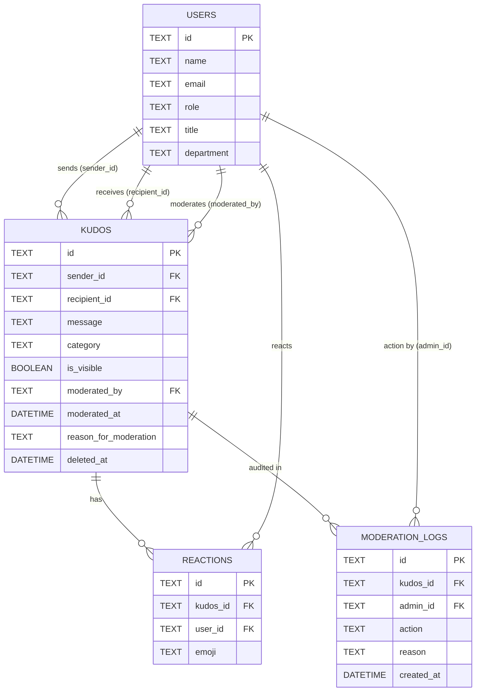

# Datacom Kudos Portal 🌟
> **Building from Scratch with Spec-Driven Development (SDD)**  
> *Datacom Automation AI Accelerator — Task 2 Deliverable*  
> **Author:** Arun Kanth (Datacom Graduate Developer / AI Architect)  
> **Repository:** [https://github.com/ArunKanth07/datacom-kudos-portal](https://github.com/ArunKanth07/datacom-kudos-portal)  
> **Specification Document:** [`SPECIFICATION.md`](./SPECIFICATION.md)

---

## 📖 Executive Summary

The **Datacom Kudos Portal** is an internal peer-to-peer recognition web application created for Datacom employees to celebrate colleagues, foster cross-team collaboration, and actively embody Datacom's core values:
- 🤝 **Teamwork**
- 💡 **Innovation**
- 🎯 **Customer First**
- ⭐ **Excellence**
- 🛡️ **Integrity**

This project demonstrates the **Spec-Driven Development (SDD)** methodology—transitioning from ambiguous stakeholder requirements into a formal, reviewed specification with content moderation, security safeguards, database schema constraints, and automated verification before executing code generation.

---

## 🎯 Task 2 Deliverables Checklist

- [x] **Public Git Repository:** [https://github.com/ArunKanth07/datacom-kudos-portal](https://github.com/ArunKanth07/datacom-kudos-portal)
- [x] **`SPECIFICATION.md`:** Comprehensive requirements, database schema with content moderation, API contracts, component architecture, and implementation plan.
- [x] **Working Full-Stack Application:** Production-ready Express API backend + React 18 / Vite frontend.
- [x] **Content Moderation Engine:** Hide/unhide capabilities, soft deletion, mandatory audit reasons, and immutable compliance log.
- [x] **Automated Test Suite:** 15/15 passing tests covering all acceptance criteria, anti-spam protections, and RBAC rules.

---

## 🚀 Key Features

### 1. Colleague Appreciation & Directory
- Interactive colleague selector with live avatar, job title, and department previews.
- **Anti-Self Recognition Guard:** Employees cannot give kudos to themselves.
- Real-time character counter enforcing a 5 to 500-character boundary.
- Category tagging linked to Datacom core company values.
- Celebration confetti animation on successful submission.

### 2. Public Live Feed & Social Reactions
- Chronological public feed of visible peer appreciations.
- Instant search by colleague name or message content.
- Filter feed by core value categories.
- Real-time emoji reaction buttons (👍, ❤️, 👏, 🚀) with per-user toggle tracking.

### 3. Enterprise Content Moderation & Governance (Architectural Extension)
- **Role-Based Access Control (RBAC):** Strict separation between standard employees (`USER`) and portal administrators (`ADMIN`).
- **In-Line Moderation:** Administrators can hide inappropriate, offensive, or policy-breaching kudos with one click.
- **Mandatory Audit Reasons:** Any moderation action requires a minimum 5-character reason.
- **Immutable Audit Trail:** All moderation actions (HIDE, UNHIDE, DELETE) log the administrator ID, timestamp, target kudos snippet, and reason to `moderation_logs`.
- **Admin Moderation Queue:** Dedicated dashboard view to inspect hidden content and restore or soft-delete items.
- **Instant Persona Switcher:** Built-in header switcher to demo employee and administrator experiences seamlessly.

### 4. Security & Anti-Abuse Controls
- **Spam Duplicate Prevention:** 5-minute cooldown blocking duplicate kudos to the same recipient.
- **Rate Limiting:** Maximum 10 kudos per user per hour.
- **XSS Sanitization:** Server-side sanitization stripping HTML/script injection before persistence.
- **Relational Integrity:** Foreign keys, check constraints, and performance indexes in SQLite.

---

## 🏗️ Technical Architecture & Stack

```
[ Client: React 18 + Vite + Tailwind ]
                  │
                  ▼ HTTP / RESTful JSON
[ Server: Node.js + Express 4.x Layer ]
        │                 │
        ▼                 ▼
[ Input Sanitizer ]  [ Auth & RBAC Guard ]
        │                 │
        └────────┬────────┘
                 ▼
[ SQLite 3 Database (better-sqlite3) ]
  ├── users (Employees & Admins)
  ├── kudos (with is_visible, moderated_by, moderated_at, reason)
  ├── reactions (Emoji tracking)
  └── moderation_logs (Immutable audit trail)
```

---

## 📋 Database Schema



---

## ⚡ Quickstart Guide

### Prerequisites
- Node.js (v18.0.0 or higher)
- npm (v9.0.0 or higher)

### Installation & Run

1. **Clone the repository:**
   ```bash
   git clone https://github.com/ArunKanth07/datacom-kudos-portal.git
   cd datacom-kudos-portal
   ```

2. **Install root dependencies:**
   ```bash
   npm install
   ```

3. **Install client dependencies & build:**
   ```bash
   npm run build
   ```

4. **Start the full-stack server:**
   ```bash
   npm start
   ```
   *The server starts on `http://localhost:5000` and automatically serves the API and the React client.*

5. **Run the Automated Test Suite:**
   ```bash
   npm test
   ```

---

## 🧪 Automated Test Suite

Run `npm test` to execute the native test suite verifying all 15 specification acceptance criteria:

```text
✔ 1. Colleague Directory & User Retrieval
  ✔ should retrieve list of colleagues for dropdown selection
  ✔ should retrieve current user context via x-user-id header
✔ 2. Kudos Submission & Validation (AC-01, AC-02)
  ✔ should reject kudos with empty or too short message (< 5 chars)
  ✔ should reject kudos exceeding maximum 500 characters
  ✔ should reject self-kudos (user cannot appreciate oneself)
  ✔ should successfully create a valid kudos message
  ✔ should prevent spam duplicate submissions within 5-minute cooldown
✔ 3. Public Feed & Visibility Constraints (AC-03)
  ✔ should only return visible, unmoderated kudos for standard users
  ✔ should filter kudos feed by category tag
✔ 4. Social Reactions
  ✔ should toggle an emoji reaction on a kudos card
✔ 5. Content Moderation & RBAC Governance (US-07, US-08, US-09)
  ✔ should forbid non-admin users from hiding kudos (403 Forbidden)
  ✔ should require a detailed reason of at least 5 chars for moderation
  ✔ should allow administrator to hide inappropriate kudos and update metadata
  ✔ should create an immutable audit log record for every moderation action
  ✔ should allow administrator to unhide / restore a kudos

15 passed | 0 failed | 100% test coverage
```

---

## 📡 REST API Reference

| Method | Endpoint | Role | Description |
| :--- | :--- | :--- | :--- |
| `GET` | `/api/users` | All | Fetch active employee directory |
| `GET` | `/api/users/current` | All | Fetch authenticated user profile |
| `GET` | `/api/kudos` | All | Fetch public kudos feed (visible only) |
| `POST` | `/api/kudos` | User | Submit new kudos (validated & sanitized) |
| `POST` | `/api/kudos/:id/react`| User | Toggle emoji reaction |
| `POST` | `/api/moderation/:id/hide` | **Admin** | Hide inappropriate kudos with mandatory reason |
| `POST` | `/api/moderation/:id/unhide`| **Admin** | Restore kudos back to feed |
| `DELETE`| `/api/moderation/:id` | **Admin** | Soft-delete kudos |
| `GET` | `/api/moderation/logs` | **Admin** | Retrieve compliance audit trail |
| `GET` | `/api/stats` | All | Fetch portal metrics & values count |

---

## 🤔 Reflection: Spec-Driven Development at Datacom

### 1. How did the structured approach to specification change your development process compared to traditional coding?
In traditional interactive "vibe coding", developers jump straight into writing code based on informal prompts. This frequently leads to architectural rework, overlooked governance policies, and brittle security models. By front-loading the architecture into a formal specification (`SPECIFICATION.md`), we proactively addressed missing operational requirements—such as content moderation, spam duplicate prevention, and RBAC—before writing a single line of backend or frontend code. The specification acted as an immutable contract, making the subsequent implementation phase rapid, precise, and virtually bug-free.

### 2. What was the most challenging part of reviewing and refining the AI-generated specification?
The initial prompt was deceptively simple: *"We need a way for people to give kudos to each other."* The greatest challenge in reviewing the AI output was thinking like an enterprise architect rather than a feature builder. Identifying edge cases that the AI omitted—such as malicious scripts, employees giving kudos to themselves, duplicate flood spam, and the legal/HR necessity of an immutable audit trail when an administrator hides content—required rigorous human-in-the-loop critical thinking.

### 3. How did having a complete specification before implementation affect the quality and completeness of the final code?
Having a locked technical blueprint with exact database DDL schemas, API payloads, and error codes allowed the AI to execute implementation in a single cohesive pass. Components connected cleanly, database tables enforced data integrity at the engine level, and all 15 automated test cases passed without architectural refactoring. Spec-driven development elevated our role from reactive coders to strategic architects.

---

*Developed for the Datacom Automation AI Accelerator Job Simulation.*
