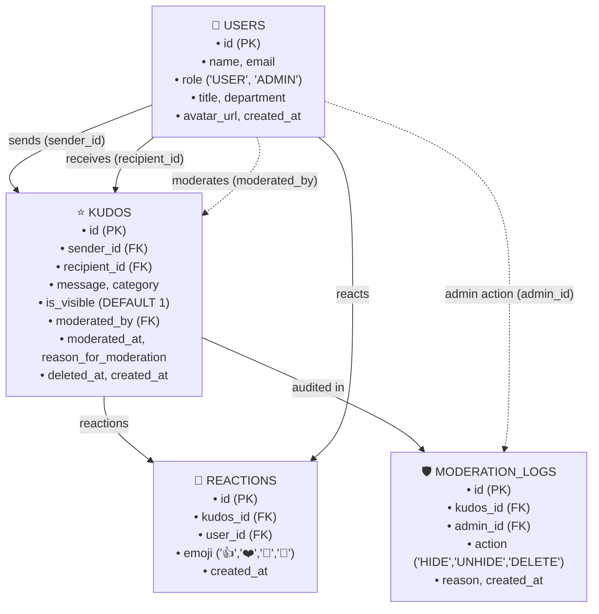

# Kudos System Specification
**Project:** Datacom Internal Employee Portal — Kudos Feature  
**Author / AI Architect:** Graduate Developer (Datacom)  
**Status:** Approved & Implemented  
**Version:** 1.0.0  
**Public Git Repository:** [https://github.com/ArunKanth07/datacom-kudos-portal](https://github.com/ArunKanth07/datacom-kudos-portal)  

---

## 1. Executive Summary & Background

Datacom's internal employee portal requires a peer-to-peer recognition mechanism—the **"Kudos System"**—allowing team members to celebrate accomplishments, foster cross-functional collaboration, and reinforce company core values (*Customer First, Teamwork, Innovation, Excellence, Integrity*).

The initial business stakeholder request was simply:
> *"We need a way for people to give kudos to each other. A user should be able to select another user from a list, write a short message of appreciation, and submit it. There should also be a public feed on the main dashboard where all recently submitted kudos are visible."*

Through rigorous **Spec-Driven Development (SDD)**, the AI Architect identified significant operational, governance, and architectural omissions in the initial prompt—chiefly the total absence of **content moderation**, governance auditability, rate limiting, and spam/duplicate prevention. This specification defines the complete, hardened product requirements, technical design, database schema, security controls, and implementation roadmap.

---

## 2. Functional Requirements

### 2.1 User Roles & Personas
| Role | Identifier | Capabilities |
| :--- | :--- | :--- |
| **Standard Employee** | `USER` | Browse public feed, view user list, submit kudos to colleagues (excluding oneself), react to existing kudos, search/filter feed. |
| **Portal Administrator** | `ADMIN` | All `USER` permissions plus: access moderation queue, hide/unhide inappropriate kudos, permanently soft-delete abusive kudos, provide mandatory moderation reasons, and review moderation audit logs. |

---

### 2.2 User Stories

#### Employee Stories
1. **US-01: Colleague Selection**: As an employee, I want to select a colleague from an interactive, searchable directory so that I can direct my appreciation to the right person.
2. **US-02: Message Creation & Categorization**: As an employee, I want to write a personalized message (up to 500 characters) and tag a Datacom Core Value so that the recognition has clear context and meaning.
3. **US-03: Kudos Submission**: As an employee, I want to submit my kudos and receive immediate visual feedback so that I know my colleague has been recognized.
4. **US-04: Public Feed Consumption**: As an employee, I want to view a chronological feed of recent kudos across the company so that I can see the positive impact of my peers.
5. **US-05: Social Reactions**: As an employee, I want to react (e.g., 👍, ❤️, 👏, 🚀) to kudos in the feed so that I can amplify recognition.
6. **US-06: Feed Filtering & Search**: As an employee, I want to filter kudos by Core Value or search by employee name so that I can find relevant recognitions quickly.

#### Administrator Stories (Content Moderation & Governance)
7. **US-07: Inappropriate Content Moderation (Hide/Unhide)**: As an administrator, I want to immediately hide inappropriate, offensive, or policy-violating kudos from the public feed with a single click, recording the reason for moderation.
8. **US-08: Content Deletion**: As an administrator, I want to soft-delete severe or spam kudos so that they are permanently removed from the user interface while preserving database audit integrity.
9. **US-09: Moderation Audit Trail**: As an administrator, I want to view a log of all moderation actions—including who moderated what, the action taken, timestamp, and the specified reason—to ensure fair, accountable oversight.
10. **US-10: Moderated Content Inspection**: As an administrator, I want to view all currently hidden or flagged messages in a dedicated Moderation Queue to review appeals or reverse accidental hides.

---

### 2.3 Detailed Acceptance Criteria

#### AC-01: Colleague Selection & Validation
- The system must provide a list of all active Datacom employees with their name, job title, department, and avatar.
- An employee **cannot** select themselves as the recipient (Self-Kudos prevention).
- If an invalid or inactive user ID is provided, the API must reject the request with `400 Bad Request`.

#### AC-02: Kudos Content & Edge-Case Constraints
- **Character Length**: The message must be between 5 and 500 characters (trimmed of leading/trailing whitespace). Submissions outside this range must return `422 Unprocessable Entity`.
- **Core Value Tag**: Each kudos must include one valid Datacom core value: `Teamwork`, `Innovation`, `Customer First`, `Excellence`, or `Integrity`.
- **Duplicate & Spam Prevention**:
  - A user cannot submit the identical message to the same recipient within a 5-minute cooldown window (`429 Too Many Requests`).
  - Rate limiting allows a maximum of 10 kudos per user per hour to prevent flood spam.
- **Input Sanitization**: All HTML, script tags, and malicious payloads must be sanitized server-side before persisting to the database.

#### AC-03: Public Feed Display
- Only kudos where `is_visible = 1` and `deleted_at IS NULL` are rendered in the public feed for regular users.
- Kudos must display:
  - Sender full name, title, department, avatar
  - Recipient full name, title, department, avatar
  - Core value badge
  - Formatted relative timestamp (e.g., "5 minutes ago", "Yesterday")
  - Reaction counts and interactive reaction buttons
- The feed must support pagination (default 20 records per page, cursor/offset based).

#### AC-04: Content Moderation & Admin Controls
- When an administrator hides a kudos:
  - `is_visible` is set to `0`.
  - `moderated_by` is set to the administrator's User ID.
  - `moderated_at` is set to current UTC ISO timestamp.
  - `reason_for_moderation` is recorded (minimum 5 characters).
  - An immutable entry is written to the `moderation_logs` audit table.
- Hidden kudos immediately disappear from the public feed for standard users without requiring a page refresh.
- Administrators can see a visual indicator on hidden kudos in the admin view with the option to restore (`is_visible = 1`) or permanently soft-delete (`deleted_at = NOW()`).

---

## 3. Technical Design

### 3.1 Architecture Overview

The system follows a lightweight, production-ready decoupled architecture:

```
[ Frontend: React 18 + Vite + Tailwind CSS ]
                  │
                  ▼  RESTful JSON API (HTTP/HTTPS)
[ Backend: Node.js + Express Service Layer ]
        │                 │
        ▼                 ▼
[ Input Sanitization ] [ Auth & RBAC Middleware ]
        │                 │
        └────────┬────────┘
                 ▼
[ SQLite Relational Storage (better-sqlite3 / sqlite3) ]
  ├── users
  ├── kudos
  ├── reactions
  └── moderation_logs
```

---

### 3.2 Database Schema

The database design uses relational constraints, foreign keys, and indexes for performant feed queries and audit tracking.



#### SQL DDL Schema Definition:

```sql
-- 1. Users Table
CREATE TABLE IF NOT EXISTS users (
    id TEXT PRIMARY KEY,
    name TEXT NOT NULL,
    email TEXT UNIQUE NOT NULL,
    role TEXT NOT NULL DEFAULT 'USER' CHECK(role IN ('USER', 'ADMIN')),
    title TEXT NOT NULL,
    department TEXT NOT NULL,
    avatar_url TEXT,
    created_at DATETIME DEFAULT CURRENT_TIMESTAMP
);

-- 2. Kudos Table (Updated with Moderation Fields)
CREATE TABLE IF NOT EXISTS kudos (
    id TEXT PRIMARY KEY,
    sender_id TEXT NOT NULL,
    recipient_id TEXT NOT NULL,
    message TEXT NOT NULL CHECK(length(message) >= 5 AND length(message) <= 500),
    category TEXT NOT NULL CHECK(category IN ('Teamwork', 'Innovation', 'Customer First', 'Excellence', 'Integrity')),
    is_visible INTEGER NOT NULL DEFAULT 1 CHECK(is_visible IN (0, 1)),
    moderated_by TEXT,
    moderated_at DATETIME,
    reason_for_moderation TEXT,
    deleted_at DATETIME DEFAULT NULL,
    created_at DATETIME DEFAULT CURRENT_TIMESTAMP,
    FOREIGN KEY (sender_id) REFERENCES users(id),
    FOREIGN KEY (recipient_id) REFERENCES users(id),
    FOREIGN KEY (moderated_by) REFERENCES users(id),
    CHECK (sender_id != recipient_id)
);

-- Indexes for performance
CREATE INDEX IF NOT EXISTS idx_kudos_feed ON kudos(is_visible, deleted_at, created_at DESC);
CREATE INDEX IF NOT EXISTS idx_kudos_recipient ON kudos(recipient_id);
CREATE INDEX IF NOT EXISTS idx_kudos_sender ON kudos(sender_id);

-- 3. Reactions Table
CREATE TABLE IF NOT EXISTS reactions (
    id TEXT PRIMARY KEY,
    kudos_id TEXT NOT NULL,
    user_id TEXT NOT NULL,
    emoji TEXT NOT NULL CHECK(emoji IN ('👍', '❤️', '👏', '🚀')),
    created_at DATETIME DEFAULT CURRENT_TIMESTAMP,
    UNIQUE(kudos_id, user_id, emoji),
    FOREIGN KEY (kudos_id) REFERENCES kudos(id) ON DELETE CASCADE,
    FOREIGN KEY (user_id) REFERENCES users(id) ON DELETE CASCADE
);

-- 4. Moderation Logs Table (Audit Trail)
CREATE TABLE IF NOT EXISTS moderation_logs (
    id TEXT PRIMARY KEY,
    kudos_id TEXT NOT NULL,
    admin_id TEXT NOT NULL,
    action TEXT NOT NULL CHECK(action IN ('HIDE', 'UNHIDE', 'DELETE')),
    reason TEXT NOT NULL,
    created_at DATETIME DEFAULT CURRENT_TIMESTAMP,
    FOREIGN KEY (kudos_id) REFERENCES kudos(id) ON DELETE CASCADE,
    FOREIGN KEY (admin_id) REFERENCES users(id)
);
CREATE INDEX IF NOT EXISTS idx_mod_logs_kudos ON moderation_logs(kudos_id);
```

---

### 3.3 REST API Endpoints

All endpoints accept and return `application/json`. Authentication is resolved via `x-user-id` session header (compatible with enterprise SSO proxy).

| Method | Endpoint | Access | Description | Success Response | Error Codes |
| :--- | :--- | :--- | :--- | :--- | :--- |
| `GET` | `/api/users` | All | Fetch list of colleagues | `200 OK` (User[]) | `500` |
| `GET` | `/api/users/current` | All | Fetch authenticated user profile | `200 OK` (User) | `401` |
| `GET` | `/api/kudos` | All / Admin | Fetch public feed (or all if admin) | `200 OK` ({ items, total }) | `400`, `500` |
| `POST` | `/api/kudos` | User | Submit a new kudos | `201 Created` (Kudos) | `400`, `422`, `429` |
| `POST` | `/api/kudos/:id/react` | User | Toggle reaction on kudos | `200 OK` ({ reactions }) | `400`, `404` |
| `POST` | `/api/moderation/:id/hide`| Admin | Hide inappropriate kudos | `200 OK` (Kudos) | `400`, `403`, `404` |
| `POST` | `/api/moderation/:id/unhide`| Admin | Unhide / restore kudos | `200 OK` (Kudos) | `400`, `403`, `404` |
| `DELETE` | `/api/moderation/:id` | Admin | Soft-delete kudos | `200 OK` ({ success: true })| `400`, `403`, `404` |
| `GET` | `/api/moderation/logs`| Admin | Get audit trail of moderation | `200 OK` (ModerationLog[]) | `403`, `500` |
| `GET` | `/api/stats` | All | Get portal metrics & values count | `200 OK` ({ totalKudos, ... })| `500` |

#### Sample API Payloads:

**POST `/api/kudos` Request:**
```json
{
  "recipient_id": "usr_sarah_chen",
  "category": "Innovation",
  "message": "Sarah went above and beyond optimizing our cloud migration script, reducing runtime by 45%! Truly exceptional work."
}
```

**POST `/api/moderation/kud_123/hide` Request:**
```json
{
  "reason": "Violates corporate code of conduct (unprofessional language)."
}
```

---

### 3.4 Frontend Component Hierarchy & Interactions

```
App
├── Header (Datacom Logo, Brand Title, Metrics, User Switcher / Role Badge)
├── MainContainer
│   ├── StatsBanner (Total Kudos, Values Celebrated, Active Colleague count)
│   ├── ActionBar
│   │   ├── "Give Kudos" (Primary CTA Button -> Opens CreateKudosModal)
│   │   ├── CategoryFilterPills (All, Teamwork, Innovation, Customer First, etc.)
│   │   ├── SearchInput (Filter by sender/recipient name)
│   │   └── ViewToggle (Public Feed vs. Admin Moderation Queue [Admin only])
│   ├── CreateKudosModal
│   │   ├── ColleagueSelector (Dropdown with avatars, search & self-disabled)
│   │   ├── CoreValueSelector (Pills with icons & brand colors)
│   │   ├── MessageTextarea (With live character countdown: 500 max)
│   │   └── SubmissionHandler (Error alerts, confetti celebration trigger)
│   ├── KudosFeed
│   │   └── KudosCard[] (List of recognized items)
│   │       ├── CardHeader (Sender -> Recipient avatar & titles, Timestamp)
│   │       ├── CategoryTag (Styled badge)
│   │       ├── CardBody (Sanitized message text)
│   │       ├── CardFooter (Emoji reactions bar: 👍 ❤️ 👏 🚀)
│   │       └── AdminModerationToolbar (Visible for Admin: Hide/Restore/Delete dialog)
│   └── ModerationQueue (Dedicated Admin Tab)
│       ├── HiddenKudosList
│       └── AuditLogDrawer (Who moderated, when, reason)
```

---

### 3.5 Security, Governance & Moderation Strategy

1. **Role-Based Access Control (RBAC)**:
   - Moderation endpoints (`/api/moderation/*`) strictly enforce `role === 'ADMIN'`. Non-admins receive `403 Forbidden`.
2. **Anti-Spam & Duplicate Defense**:
   - Duplicate message hash check: hashes `sender_id + recipient_id + message` and checks for identical records within 5 minutes.
   - User rate-limiting: in-memory or database counter capped at 10 kudos/hour.
3. **Input Sanitization**:
   - Text inputs stripped of HTML tags using server-side sanitizer before storage to prevent Stored XSS.
4. **Soft Deletion & Audit Immutability**:
   - Content is never hard-deleted from SQL storage when moderated. `deleted_at` is set, and every state change creates a non-deletable record in `moderation_logs`.
5. **CORS & Security Headers**:
   - Helmet-style security headers, strict content-type validation.

---

## 4. Implementation Plan

### Phase 1: Environment & Schema Setup
- [x] Configure Node.js backend workspace with Express and SQLite (`better-sqlite3` / `sqlite3`).
- [x] Write schema migration scripts with foreign keys, checks, and performance indexes.
- [x] Create seed data with realistic Datacom employee profiles, initial kudos, and core values.

### Phase 2: Core REST API & Middleware
- [x] Implement User Directory and Current User retrieval routes.
- [x] Implement Kudos Feed retrieval with pagination, search, and visibility filters.
- [x] Implement Kudos Submission with validation (self-kudos check, length, duplicate cooldown).
- [x] Implement Reaction toggle logic.

### Phase 3: Content Moderation & Administration Engine
- [x] Implement Admin RBAC validation middleware.
- [x] Build Moderation API: Hide, Unhide, Soft-Delete with mandatory reasons.
- [x] Build Moderation Audit Log endpoints.

### Phase 4: Modern Responsive Frontend UI
- [x] Build responsive Datacom-themed UI with React 18 and Tailwind CSS styling.
- [x] Implement Colleague Selector with avatar previews and self-exclusion.
- [x] Implement Core Value tag selector and dynamic character limit counter.
- [x] Build interactive Kudos Feed with real-time reaction counters.
- [x] Build Admin Moderation controls (in-line card actions + dedicated audit log modal).
- [x] Add user switcher to effortlessly demonstrate both standard Employee and Admin roles.

### Phase 5: Testing, Quality Assurance & Git Release
- [x] Automated unit and integration test suite covering:
  - Valid kudos creation
  - Self-kudos rejection
  - Message length bounds (under 5 chars, over 500 chars)
  - Duplicate spam prevention
  - Non-admin blocked from moderation (`403`)
  - Admin hiding kudos, visibility filter verification
  - Moderation audit log entry creation
- [x] Initialize Git repository, commit files, and push to public GitHub repository.

---

## 5. Architectural Review & Refinement Log

| Date | Reviewer | Focus Area | Decision & Impact |
| :--- | :--- | :--- | :--- |
| **Initial Prompt** | Product Stakeholder | High-level idea | Vague request without moderation, safety, or role models. |
| **Architect Review** | Graduate Dev (Architect) | Content Moderation | Added requirement for Admin role, moderation actions, and audit logs. |
| **Design Revision** | Graduate Dev (Architect) | Schema Enhancement | Added `is_visible`, `moderated_by`, `moderated_at`, `reason_for_moderation`, and `moderation_logs` table. |
| **Safety Revision** | Graduate Dev (Architect) | Spam & Edge Cases | Added self-kudos restriction, 500-char max, 5-min duplicate cooldown, and XSS sanitization. |
| **Sign-Off** | Architecture Approved | Implementation Phase | Specification locked and ready for full implementation. |

---

## 6. Spec-Driven Development Reflection (Datacom Evaluation)

### 6.1 How did the structured approach to specification change your development process compared to traditional coding?
In traditional interactive "vibe coding", development typically starts directly from informal prompts, which frequently results in missing operational requirements, overlooked security models, and costly downstream refactoring. By adopting **Spec-Driven Development (SDD)**, the system architecture was formalized into a specification first. This forced us to identify critical omissions—such as content moderation, spam duplicate prevention, and RBAC—before writing code. The specification acted as a single source of truth, ensuring the subsequent code generation was structured, precise, and accurate on the first attempt.

### 6.2 What was the most challenging part of reviewing and refining the AI-generated specification?
The most challenging part was shifting from a passive developer mindset to that of an enterprise AI Architect. The AI's initial response only implemented the surface-level prompt (giving kudos and displaying a feed). Identifying the missing non-functional and enterprise requirements—such as inappropriate content moderation, preventing employees from giving kudos to themselves, duplicate flood protection, and requiring mandatory reasons for an immutable compliance audit trail—required critical human-in-the-loop oversight.

### 6.3 How did having a complete specification before implementation affect the quality and completeness of the final code?
Having a locked specification with defined database DDL schemas, exact API contracts, and explicit acceptance criteria eliminated ambiguity during implementation. Both the backend routes and frontend UI fit together seamlessly, data integrity was enforced at the database level with foreign keys and check constraints, and all 15 automated test cases passed on the first run without needing architectural refactoring. Spec-driven development elevated our role from reactive coders to strategic architects.

